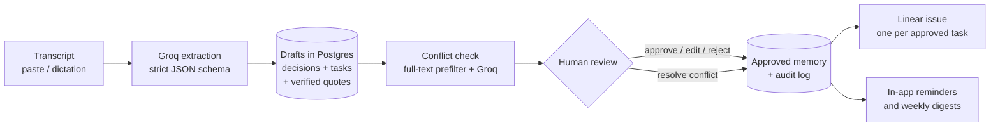
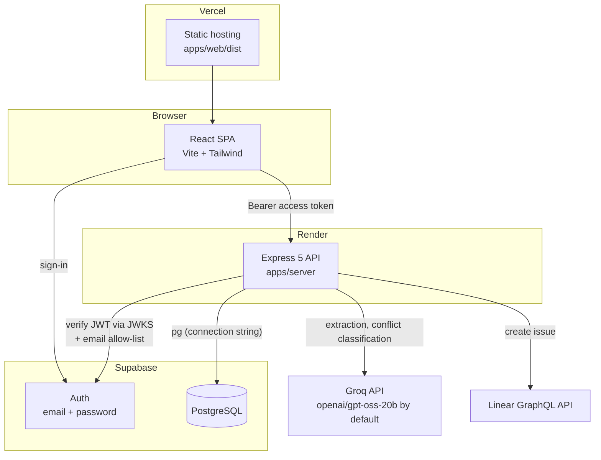

# Recall

**Cross-meeting decision memory with contradiction detection and human-approved execution.**

Most meeting tools summarise one meeting at a time. Recall remembers every approved decision across meetings, flags when a new meeting contradicts or changes an earlier one, and only pushes work to Linear after a person has approved it.

Paste a speaker-labelled transcript (or a dictated recap), and Recall:

1. extracts decisions, tasks, owners, deadlines and the exact transcript quotes behind each one (Groq);
2. stores them as **drafts** in a persistent memory (PostgreSQL on Supabase);
3. compares new decisions with related approved decisions from earlier meetings and raises **conflicts** for review;
4. waits for a human to approve, reject or edit each item, recording every step in an append-only audit log;
5. creates a Linear issue for each approved task, at most once;
6. generates in-app reminders and per-owner weekly digests from approved work.

| | |
| --- | --- |
| **Live demo** | _Not deployed yet. Add the URL here once Vercel is live._ |
| **API (Render)** | _Not deployed yet. Add the URL here._ |
| **Walkthrough video** | _Not recorded yet. Add a link here._ |

## Screenshots

> Placeholders. Capture these from a running instance and save them under `docs/screenshots/` (the folder does not exist yet).

| Screen | File |
| --- | --- |
| Meetings list | `docs/screenshots/meetings.png` _(to add)_ |
| Extracted decisions and tasks with evidence quotes | `docs/screenshots/meeting-detail.png` _(to add)_ |
| Conflict review (old vs. new decision) | `docs/screenshots/conflict-review.png` _(to add)_ |
| Approvals queue | `docs/screenshots/approvals.png` _(to add)_ |
| Reminders and weekly digests | `docs/screenshots/reminders.png` _(to add)_ |

## What makes it different

- **Memory across meetings.** Approved decisions persist. A new meeting is checked against related earlier decisions, not just summarised in isolation.
- **Contradiction detection with a human in the loop.** A model proposes conflicts; it never resolves them. A person chooses to keep the old decision, accept the new one (which supersedes the old), or dismiss a low-confidence flag.
- **Evidence, not assertions.** Every extracted item carries quotes that are verified against the stored transcript, ignoring case and punctuation. The `Speaker:` prefix that models echo is accepted only if it names the speaker of the segment containing the quote, and ellipsis-joined fragments must appear in order in one segment. Anything else is dropped rather than stored ([quotes.ts](apps/server/src/meetings/quotes.ts)).
- **Nothing reaches Linear unapproved.** Approval is the only gate to Linear, enforced in server code and by database constraints.
- **Auditable.** Every approval, rejection, edit, conflict resolution and sync attempt is written to an append-only table in the same transaction as the change.

## How it works



### Architecture



The browser talks to Supabase only to sign in. All data access goes through the API, which connects to Postgres directly. Row level security is enabled on every table with no policies, so the Supabase Data API cannot read or write Recall's data.

## Tech stack

| Layer | Technology (from `package.json`) |
| --- | --- |
| Web | React 19, Vite 8, TypeScript, Tailwind CSS 4, React Router 8, `@supabase/supabase-js` |
| API | Node 22+, Express 5, TypeScript, `pg`, Zod 4, `jose` (JWT verification) |
| Database | Supabase PostgreSQL (plain SQL migrations, full-text search with a GIN index) |
| AI | Groq's OpenAI-compatible chat completions API, default model `openai/gpt-oss-20b` |
| Task tracker | Linear (GraphQL API) |
| Tooling | pnpm workspaces, `tsx` and the Node test runner |
| Hosting (configured, not yet deployed) | Vercel (web), Render (API, `render.yaml`), Supabase (auth and database) |

## Repository structure

```
apps/
  server/            Express API
    src/ai/            Groq client, prompts, Zod schemas
    src/meetings/      ingest, extraction persistence, conflict detection, due-date resolution
    src/approvals/     approve / reject / edit, conflict resolution, Linear sync, audit
    src/notifications/ reminders and weekly digests
    src/routes/        HTTP route definitions
    src/security/      auth, CORS, rate limiting, headers, production config checks
    src/scripts/       migrate.ts
  web/               React client (login, meetings, approvals, reminders & digests)
packages/
  shared/            Types and constants shared by server and web
supabase/
  migrations/        Ordered SQL migrations (6 files)
render.yaml          Render blueprint for the API
```

## Database design

Migrations live in [supabase/migrations/](supabase/migrations/) and are applied in filename order by `pnpm db:migrate`.

| Table | Purpose |
| --- | --- |
| `meetings` | Title, date, source (`paste`, `dictation`, `upload`), original transcript, participants, status (`ingested`, `extracting`, `extracted`, `failed`), conflict-check status |
| `transcript_segments` | The transcript split into speaker segments (speaker label corrections applied) |
| `people` | Owners and speakers, unique by lower-cased name |
| `decisions` | Status `proposed`, `active`, `superseded`, `rejected`; a generated `tsvector` column with a GIN index (active rows) powers retrieval; `version` for optimistic concurrency |
| `tasks` | Status `proposed`, `approved`, `rejected`, `synced`, `done`; owner, due date and the spoken phrase; Linear id/URL and sync state |
| `evidence` | Verified quote and segment for a decision or a task |
| `ambiguities` | Things the model flagged as unclear (no owner, vague deadline) |
| `decision_conflicts` | New decision ↔ earlier decision, kind, relation, certainty, explanation, previous/new value, evidence, resolution |
| `audit_events` | Append-only history of changes to decisions, tasks and conflicts |
| `reminders`, `digests` | In-app reminders (unique per task and due date) and per-person weekly digests (unique per person and week) |

Invariants enforced in the database, not only in application code:

- A task cannot be `approved` or `synced` without `approved_at`, cannot be `synced` without a Linear id and URL, and `(external_provider, external_id)` is unique.
- A decision's summary and rationale cannot change once it leaves `proposed` (trigger).
- `audit_events` rejects `UPDATE`, `DELETE` and `TRUNCATE` (triggers).
- A reminder can only be created for an approved or synced task whose due date matches (trigger), and `(task_id, due_date)` is unique.
- A conflict is `open` exactly when it has no `resolved_at`.

Schema notes: the `decisions.status` value `reversed` and the `speaker_aliases` table exist in the schema but nothing in the application uses them yet.

## Conflict detection

Implemented in [apps/server/src/meetings/conflicts.ts](apps/server/src/meetings/conflicts.ts). It runs automatically at the end of `POST /api/meetings/:id/analyze` and can be re-run with `POST /api/meetings/:id/conflicts/check`.

1. **Scope.** Only the meeting's `proposed` decisions are checked, oldest first, up to **20** per run (`MAX_COMPARED_DECISIONS`).
2. **Candidate retrieval (no model call).** For each new decision, English-stemmed subject terms are extracted with Postgres (generic words such as "decided" or "team" and month abbreviations are normalised). A GIN-indexed full-text query returns up to **50** (`PREFILTER_LIMIT`) `active` decisions from *other* meetings dated on or before this meeting.
3. **Ranking.** Candidates are kept if they share at least two subject terms with the new decision, or one term when the two meeting titles share a term (same project). They are ordered by shared terms, then same project, then recency, and capped at **5** per decision (`MAX_CANDIDATES_PER_DECISION`). Up to 3 evidence quotes per decision are sent as context.
4. **Classification (Groq).** One call receives all new decisions with their `compareWith` lists and the earlier decisions, labelled `N1…` / `E1…` instead of database ids. For each listed pair the model returns `changes`, `contradicts`, `confirms` or `unrelated`, a kind (`deadline`, `ownership`, `scope`, `budget`, `cancellation`, `other`), a `certain` flag, previous and new values, an evidence quote, and an explanation.
5. **Guardrails in code.** Pairs the model was not asked about are discarded; `confirms` and `unrelated` are dropped; a statement containing hedging words ("maybe", "might", "if we", "tbd", …) is always marked `uncertain` regardless of what the model said; the evidence quote must be found in this meeting's transcript.
6. **Storage.** Conflicts are saved in one transaction under a lock on the meeting. Re-running replaces *open* conflicts and keeps resolved ones. If the Groq call fails, previously stored conflicts are untouched and the meeting's `conflictCheck.status` becomes `failed` (the extraction is not lost).

**Review rules** (see [apps/server/src/approvals/](apps/server/src/approvals/)):

- A **clear** open conflict blocks approving the new decision. Resolve it with `keep_old` (new draft rejected, old decision untouched) or `accept_new` (old decision becomes `superseded`, pointing to the new one, which becomes `active`).
- An **uncertain** conflict does not block approval. It can be `dismiss`ed, or is closed automatically when the decision is approved or rejected; the audit entry records why.
- `accept_new` is refused while the new decision has other unresolved clear conflicts.
- Resolved conflicts are kept as history. The UI shows open (red), uncertain (amber) and resolved or dismissed (neutral, with the outcome and date) differently, and a decision only shows a conflict warning while one of its conflicts is still open.

## Approval safety, transactions and audit

- **Drafts first.** Extraction creates `proposed` decisions and tasks only. Re-analysis replaces drafts but is refused (409) once any item on the meeting has been approved.
- **Transactions and lock order.** Every approve, reject, edit, complete and conflict resolution runs in a single transaction that takes locks in a fixed order (meeting, then decisions by id, then conflicts), so concurrent actions serialise. Analysis and conflict checks take the meeting lock exclusively; approvals take it shared, so they cannot interleave with re-analysis.
- **Optimistic concurrency.** Edits and approvals accept a `version`; a stale value returns `409`.
- **Idempotent actions.** Approving an already approved item, or rejecting a rejected one, is a no-op rather than an error.
- **Audit history.** `audit_events` records entity, action, from/to status, actor and details, written in the same transaction as the change. The actor is always the verified signed-in email from the token, never a value from the request body. Read it with `GET /api/audit?entityType=…&entityId=…`.
- **Linear sync is at-most-once per task.**
  - Only `approved` tasks without an external id can be synced, and approval itself triggers one sync attempt when Linear is configured. A failed attempt does not undo the approval; the error is stored on the task and `POST /api/tasks/:id/sync` retries.
  - The claim is a single atomic `UPDATE` to `sync_status = 'syncing'`, so concurrent requests cannot both create an issue. An abandoned claim is retaken after 90 seconds.
  - Each issue description contains a marker (`recall-task:<task id>`). Before any *retry*, Recall searches the configured Linear team for that marker and adopts an existing issue instead of creating a duplicate.
  - Success stores the Linear id and URL and marks the task `synced`, with an audit entry.
  - Decisions are not sent to Linear; only approved tasks are.

## Reminders and digests

Both are **in-app only**. Nothing is emailed or sent anywhere, and the API says so in a `delivery` field. `RESEND_API_KEY` and `EMAIL_FROM` are read only to report an email status in `/api/health`; no email code exists.

- **Reminders** are created by an explicit `POST /api/reminders/generate` for approved or synced tasks with a due date that falls inside a window (default 24 h, 1 to 720 h). Generation is idempotent per task and due date; `GET` endpoints never write.
- **Digests** group each owner's overdue, upcoming (next 7 days) and completed-this-week tasks. Only owners matched to a known person are stored (one row per person per week; regenerating refreshes it).
- Relative deadlines such as "next Friday" are resolved in code against the meeting date ([dates.ts](apps/server/src/meetings/dates.ts)) and override the model's date when the phrase is recognised. Unresolvable deadlines are dropped and listed as ambiguities.

## Security

Recall is a single-workspace app: every allow-listed user can see and act on everything. There are no per-user or per-team permissions.

- **Authentication.** Supabase email and password. The server verifies the access token itself ([auth.ts](apps/server/src/security/auth.ts)): signature (the project's JWKS, or the legacy HS256 secret if `SUPABASE_JWT_SECRET` is set), issuer, audience, expiry and role. Anonymous sessions are refused. Tokens are not checked for revocation, so a token stays valid until it expires (Supabase's default is one hour).
- **Allow-list.** A valid Supabase account whose email is not in `AUTH_ALLOWED_EMAILS` gets `403`. An empty list means nobody can use the API. Public signup should be disabled in Supabase.
- **Fail closed.** With no Supabase configuration, protected routes answer `503`. With `NODE_ENV=production` the server refuses to start unless `APP_URL` and `CORS_ORIGINS` are public https origins, Supabase is configured and the allow-list is non-empty.
- **CORS.** Only `APP_URL` and `CORS_ORIGINS` are allowed; preflights from other origins get `403`. Auth is a bearer header, never a cookie.
- **Rate limits** (in memory, per process; fixed windows):

  | Scope | Limit | Key |
  | --- | --- | --- |
  | Whole API | 300 / minute | client IP |
  | `analyze`, `conflicts/check` (AI calls) | 20 / 10 min | user |
  | create meeting, approve task, sync task, generate reminders / digests | 60 / 10 min | user |

  Exceeding a limit returns `429` with `Retry-After`. Set `TRUST_PROXY=1` behind Render so the IP key is the real client.
- **Other.** Request bodies are limited to 512 kB (transcripts to 50,000 characters) and parsed only after authentication; security headers (`nosniff`, `X-Frame-Options: DENY`, no-referrer, HSTS in production); request logs contain method, path, status and duration only; secrets are read by the server only.
- **Database.** RLS is on for every table with no policies, and the `anon` and `authenticated` roles have their grants revoked (migration `20261101000000_auth_hardening.sql`). Authorization is enforced by the Express server, which connects with a privileged role.

## API

All routes are under `/api`. Unless marked public they require `Authorization: Bearer <Supabase access token>` from an allow-listed email. Route definitions: [app.ts](apps/server/src/app.ts), [routes/](apps/server/src/routes/).

| Method | Path | Purpose | Notable errors |
| --- | --- | --- | --- |
| GET | `/health` _(public)_ | Service status: database, Groq/Linear/email configuration. Also available unauthenticated at `/healthz` (plain `ok`, no database call) | `503` when the database is down |
| GET | `/auth/config` _(public)_ | Supabase URL and anon key for the browser, or `{enabled:false}` | |
| GET | `/me` | Current user (id, email) | |
| GET | `/meetings` | List meetings with decision and task counts | |
| POST | `/meetings` | Ingest a transcript (`title`, `occurredAt` YYYY-MM-DD, `transcript` ≤ 50,000 chars, optional `participants`, `source`, `speakerMap`). Returns `201` with the meeting | `400` validation |
| GET | `/meetings/:id` | Meeting with segments, decisions, tasks, ambiguities, conflicts | `404` |
| POST | `/meetings/:id/analyze` | Extract with Groq, then check conflicts | `409` already running or items approved; `429` Groq rate limit; `502` Groq failure |
| GET | `/meetings/:id/conflicts` | Conflict-check status and conflicts | `404` |
| POST | `/meetings/:id/conflicts/check` | Re-run only the conflict check; returns the meeting | `409` not analyzed yet; `429`/`502` Groq |
| GET | `/approvals` | Approval queue: proposed decisions and tasks, open conflicts, and approved tasks awaiting Linear sync | |
| GET | `/audit?entityType=&entityId=` | Audit history (`decision`, `task` or `conflict`) | `400` |
| GET | `/decisions/:id` | Decision detail | `404` |
| PATCH | `/decisions/:id` | Edit `summary` / `rationale` of a proposed decision | `400` nothing to change; `409` not proposed or stale `version` |
| POST | `/decisions/:id/approve` | `proposed → active` | `409` open clear conflict, wrong state or stale `version` |
| POST | `/decisions/:id/reject` | `proposed → rejected` | `409` |
| POST | `/conflicts/:id/resolve` | Body `{action: "keep_old" \| "accept_new" \| "dismiss"}` | `404`; `409` already resolved differently, `dismiss` on a clear conflict, or other unresolved conflicts |
| PATCH | `/tasks/:id` | Edit title, description, owner, due date of a proposed task | `400`; `409` |
| POST | `/tasks/:id/approve` | `proposed → approved`, then one Linear sync attempt if configured. Returns the task, including any `syncError` | `409` |
| POST | `/tasks/:id/reject` | `proposed → rejected` | `409` |
| POST | `/tasks/:id/sync` | Send an approved task to Linear, or retry | `503` Linear not configured; `409` not approved or sync in progress; `502` Linear failure |
| POST | `/tasks/:id/complete` | `approved`/`synced → done` | `409` wrong state or sync in progress |
| GET | `/reminders` | In-app reminder inbox | |
| GET | `/reminders/preview?windowHours=` | What would be generated (no writes) | `400` window outside 1 to 720 |
| POST | `/reminders/generate` | Create reminders (idempotent). Body `{windowHours}` | `400` |
| POST | `/reminders/:id/read` | Mark read; returns the inbox | `404` |
| GET | `/digests` | Stored weekly digests | |
| GET | `/digests/preview` | Current week's digest (no writes) | |
| POST | `/digests/generate` | Store this week's digest per known owner | |

Common behaviour:

- **Error body:** `{ "error": string, "code"?: string, "details"?: … }`. Validation errors (`400`) list `details` as `{path, message}` entries; invalid UUIDs and malformed JSON are also `400`.
- **Auth:** `401` missing or invalid token (with `WWW-Authenticate`; codes `missing_token`, `session_expired`, `invalid_token`), `403` not on the allow-list, `503` auth not configured or the JWKS is unreachable.
- **Other:** `404` unknown route or resource, `429` rate limited (`code: "rate_limited"`), `500` unexpected errors (no internals leaked). Responses under `/api` are `Cache-Control: no-store`.
- Request bodies for approvals are strict: unknown fields are rejected. An `actor` field is accepted from older clients and ignored.

## Local setup

Requires Node 22+ and pnpm, a Supabase project (database and auth) and a Groq API key. Linear is optional.

```bash
pnpm install
cp .env.example .env     # fill in DATABASE_URL, GROQ_API_KEY, SUPABASE_URL, SUPABASE_ANON_KEY, AUTH_ALLOWED_EMAILS
pnpm db:migrate          # applies supabase/migrations/*.sql
pnpm dev                 # API on :8787, web on :5173 (Vite proxies /api)
```

Open http://localhost:5173 and sign in. The server exits at startup with a list of what to fix if required variables are missing or malformed.

### Supabase sign-in

1. Authentication → Sign In / Providers: keep **Email** on and turn **off** "Allow new users to sign up".
2. Authentication → Users → Add user: create an account (auto-confirm) for each person.
3. Put the same emails in `AUTH_ALLOWED_EMAILS`. Set `SUPABASE_JWT_SECRET` only for projects still on the legacy HS256 secret.

### Environment variables (server, in the repo-root `.env`)

| Variable | Required | Purpose |
| --- | --- | --- |
| `DATABASE_URL`, `DATABASE_SSL` | yes (`DATABASE_SSL` defaults to `true`) | Postgres connection string; `false` for a local Postgres without TLS |
| `GROQ_API_KEY` | yes | Groq key. Optional: `GROQ_MODEL` (default `openai/gpt-oss-20b`), `GROQ_BASE_URL` |
| `SUPABASE_URL`, `SUPABASE_ANON_KEY` | yes for sign-in | Public values served to the browser. Never use the `service_role` key |
| `SUPABASE_JWT_SECRET` | legacy only | HS256 projects |
| `AUTH_ALLOWED_EMAILS` | yes for access | Comma-separated allow-list; empty means nobody |
| `APP_URL`, `CORS_ORIGINS` | `APP_URL` defaults to `http://localhost:5173` | Allowed browser origins |
| `TRUST_PROXY` | no (default `0`) | Number of reverse proxies in front of the API |
| `LINEAR_API_KEY`, `LINEAR_TEAM_ID` | no | Both are needed to sync tasks; otherwise approved tasks stay local |
| `RESEND_API_KEY`, `EMAIL_FROM` | no | Only toggle an email indicator in `/api/health`; no email is sent |
| `NODE_ENV`, `PORT` | no | `development` and `8787` by default |

Web (`apps/web`): optional `VITE_API_BASE_URL`, needed only when the API is on another origin.

### Scripts

| Command | What it does |
| --- | --- |
| `pnpm dev` | Builds shared types, then runs shared (watch), API and web |
| `pnpm typecheck` | Type-checks every package |
| `pnpm test` | Server tests (Node test runner) |
| `pnpm build` | Builds shared, server (`apps/server/dist`) and web (`apps/web/dist`) |
| `pnpm start` | Runs the built server |
| `pnpm db:migrate` | Applies pending migrations in a transaction each and records them in `schema_migrations` |

### Tests

`pnpm test` runs the server suite: unit tests (Groq client, conflict ranking, date resolution, auth and rate limiting) and integration tests against PostgreSQL. The database tests use `DATABASE_URL` from `.env` and are **skipped when the database is unreachable**; with a database configured they run for real. Groq and Linear are replaced with fakes, so tests never call those services. The database tests create and roll back or tag their own rows; point `DATABASE_URL` at a development database, not one holding data you care about. Last run: 108 of 108 tests pass, with typecheck and build clean.

## Deployment (Vercel + Render + Supabase)

Configuration is in the repo; nothing has been deployed yet. The web app and API live on different origins. Auth is a bearer token, so there are no cookies and CORS needs no credentials. Create the Render service first (to get its URL), then Vercel, then set `APP_URL` on Render and redeploy it.

1. **Migrations** (from your machine; the server never migrates on boot): set the production `DATABASE_URL` and run `pnpm db:migrate`. Re-run after any release that adds a migration. Use either this script or `supabase db push`, not both, because they track applied migrations separately.
2. **Supabase:** Email provider on, signup off, users created manually. Site URL and Redirect URLs set to the Vercel URL.
3. **Render (API):** New → Blueprint from `render.yaml`, or a Web Service with build `pnpm install --frozen-lockfile --prod=false && pnpm --filter @recall/shared build && pnpm --filter @recall/server build`, start `node apps/server/dist/index.js`, health check `/healthz`, `NODE_VERSION=22`. Auto-deploy is off. Set the secrets marked `sync: false` in the dashboard: `APP_URL` (exact Vercel origin, https, no path), `DATABASE_URL`, `GROQ_API_KEY`, `SUPABASE_URL`, `SUPABASE_ANON_KEY`, `AUTH_ALLOWED_EMAILS`, and optionally `SUPABASE_JWT_SECRET`, `CORS_ORIGINS`, Linear variables. `NODE_ENV=production`, `TRUST_PROXY=1` and `DATABASE_SSL=true` are preset. On SIGTERM the server drains in-flight requests (up to 25 s) and closes the pool.
4. **Vercel (web):** Root Directory `apps/web` (keep "Include source files outside of the Root Directory" on), Node 22. Install and build commands come from `apps/web/vercel.json`. Set `VITE_API_BASE_URL` to the Render origin (no trailing slash, no `/api`) **before building**, because it is baked into the bundle. The Supabase URL and anon key are fetched at runtime from `/api/auth/config`. `vercel.json` rewrites unknown paths to `index.html` and adds security headers.
5. **Smoke test:**

   ```bash
   curl -i https://<api>/healthz                  # 200 ok
   curl -s https://<api>/api/health               # database: ok
   curl -i https://<api>/api/meetings             # 401 without a token
   curl -i -X OPTIONS https://<api>/api/meetings \
     -H "Origin: https://<web>" -H "Access-Control-Request-Method: POST"   # 204 with allow-origin = web
   ```

   Then sign in with an allow-listed account at `https://<web>/login`. Vercel preview URLs are not allowed by CORS unless listed in `CORS_ORIGINS`.

### Deployment checklist

- [ ] Supabase: project created; email sign-in on, public signup off; users created manually; Site URL and Redirect URLs set to the Vercel URL
- [ ] Migrations: `pnpm db:migrate` run from your machine against the production `DATABASE_URL`
- [ ] Render: service from `render.yaml`; secrets set in the dashboard; `APP_URL` is the exact Vercel origin; `/healthz` returns 200
- [ ] Vercel: root `apps/web`; `VITE_API_BASE_URL` set to the Render origin **before** the first build
- [ ] Smoke test with the `curl` commands above, then sign in with an allow-listed account
- [ ] Only then: fill in the demo, API, screenshot and video placeholders at the top of this file

## Features

- Transcript ingest from pasted, speaker-labelled text or unlabelled dictation (Wispr Flow output works as pasted text; there is no direct integration)
- Structured extraction of decisions, tasks, owners, deadlines and ambiguities with verified evidence quotes
- Cross-meeting conflict detection with clear / uncertain grading and three resolution actions
- Edit, approve and reject workflow with optimistic concurrency and an audit trail
- Idempotent Linear issue creation with retry and duplicate adoption
- In-app reminders and weekly per-owner digests
- Supabase authentication with an email allow-list, rate limiting and production fail-closed checks

## Tradeoffs

- **Retrieval before the model.** A full-text prefilter bounds model cost and prompt size, but a conflict between two decisions that share fewer than two subject terms (and no project title term) is never compared.
- **Model proposes, human decides.** Every model judgement ends in a review step, at the cost of manual work per meeting.
- **Server-side authorization.** Simple and auditable for a small team, but it relies on the Express layer rather than per-row database policies.
- **In-memory rate limiting.** No extra infrastructure, but limits reset on restart and are per instance.

## Limitations

- Invite-only: no per-user or per-team permissions, and no signup flow (an admin creates accounts and lists their emails in `AUTH_ALLOWED_EMAILS`).
- Linear issues are created with a title and description only. Task owners are **not** mapped to Linear assignees, and Linear status is not synced back.
- Evidence for items approved before the speaker-prefix fix is missing. Quotes the old verifier rejected were never stored, so those decisions and tasks show "No supporting quote found in the transcript"; they cannot be recovered, and meetings with approved items cannot be re-analyzed. New analyses are not affected.
- Conflict detection compares only active decisions from meetings dated on or before the current one, at most 5 candidates per decision and 20 decisions per run. Quality depends on the Groq model; there are no accuracy benchmarks.
- English-only full-text search and prompts.
- Reminders and digests are in-app only: no email or chat is sent automatically. The web app has no People directory yet (the page says so).
- `upload` exists as a meeting source value, but there is no file-upload endpoint; transcripts are submitted as text.
- Access tokens are not revocable before expiry.
- Rate limiting is in memory and per process: limits reset on restart and are not shared, so run a single API instance.
- Not yet verified in production: nothing has been deployed, so the Vercel, Render and Supabase setup below is untested end to end.

## Future improvements

- Email or chat delivery for reminders and digests, behind explicit approval (the schema already has `sent_at` / `send_approved_at` columns with a check that sending requires approval)
- Audio or file upload and speech-to-text
- Per-user roles and workspaces
- Shared rate-limit store for multi-instance deployments
- Embedding-based retrieval to complement keyword matching, with an evaluation set for conflict precision and recall
- People directory and owner-level views
- Sync status back from Linear

## License

No license file has been added yet. Add one before publishing if you want others to reuse the code.
